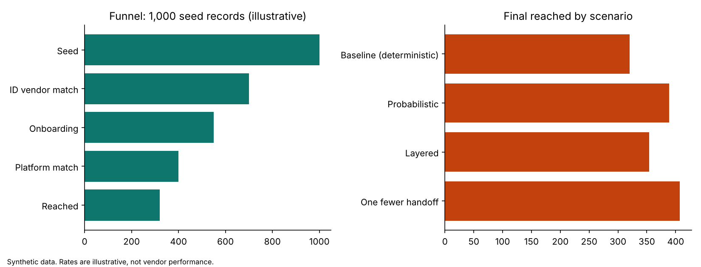

# identity-match-loss

A small, fully synthetic project that shows **where an audience shrinks as it moves between identity systems**, and how governance checks keep bad records from moving along with it.

> All data and rates here are made up for illustration. Nothing reflects real vendor performance or any client.



## What it does

1. **Funnel simulator** (`simulator.py`): seed, ID vendor match, onboarding, platform match, reached. Each step has a retention rate and a plain-language reason for the loss.
2. **Scenarios**: swap match type, remove a handoff, or layer deterministic with probabilistic.
3. **Objective switch**: `reach` favors larger (probabilistic) audiences, `conversion` and `regulated` require a higher precision floor (deterministic).
4. **Data contracts** (`contracts.py`): Pydantic validators on fake Acxiom-style and Epsilon-style CSVs. A broken record is flagged with its errors, not passed along. Examples: IDs must match a format, deciles between 1 and 10, `email_count` must equal the non-blank emails, an opted-out record can never be activated.

## Findings from the default (illustrative) numbers

| Scenario | Reached from 1,000 seed |
|---|---|
| Baseline (deterministic) | 320 |
| Probabilistic | 389 |
| Layered | 354 |
| One fewer handoff | 407 |

Removing a handoff beats a modest gain in the match rate. Probabilistic raises reach but lowers precision, which is why the objective decides the method.

## Run it

```bash
pip install -e .
pytest
python make_chart.py
```

## Layout

```
src/identity_match_loss/   simulator.py, contracts.py
data/                      synthetic CSVs (2 rows per file deliberately broken)
tests/                     funnel, scenario and contract tests
make_chart.py              regenerates docs/funnel.png
```

## Limits

- Rates are assumptions. Replace them with logged counts from a real seed file run through each vendor, and confirm with a holdout test.
- No claims are made about any vendor's graph, partnerships or match rates.
